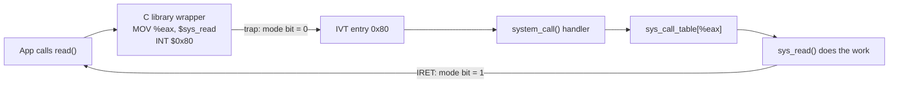

# Systems and Networking I — Part I: Introduction

Study notes for **Lecture 1 (Introduction)** and **Lecture 2 (Computer Architecture and OS Structures)**.

> Exam format: multiple choice, ~20 questions, **+3** correct, **−1** wrong, **0** blank. Don't guess blindly.

## Table of contents

1. [What an OS is](#1-what-an-os-is)
2. [Kernel vs OS and the mode bit](#2-kernel-vs-os-and-the-mode-bit)
3. [Hardware basics](#3-hardware-basics)
4. [Instruction cycle and instructions per second](#4-instruction-cycle-and-instructions-per-second)
5. [History, architecture and design issues](#5-history-architecture-and-design-issues)
6. [Protection: modes, privileged instructions, traps](#6-protection-modes-privileged-instructions-traps)
7. [System calls](#7-system-calls)
8. [Timer, atomic instructions, virtual memory](#8-timer-atomic-instructions-virtual-memory)
9. [OS design and structures](#9-os-design-and-structures)
10. [Exam traps (all of Part I)](#10-exam-traps-all-of-part-i)
11. [Practice questions (Rounds 1–4)](#11-practice-questions-rounds-14)
12. [Exam-style questions](#12-exam-style-questions)
13. [Oral exam questions](#13-oral-exam-questions)
14. [Textbook exercises (Silberschatz, Ch. 1–2)](#14-textbook-exercises-silberschatz-ch-12)

---

## 1. What an OS is

An **operating system** is the software layer between the hardware and user programs. It manages the hardware and gives programs an easier, safer way to use it.

**Lecture definition:** *"Implementation of a virtual machine that is (hopefully) easier to program than bare hardware."* A program calls `read()` or `write()`; the OS deals with the specific disk, network card and RAM.

```
User
Application programs (browsers, compilers, games…)
Operating system
Hardware (CPU, memory, I/O devices)
```

### The 3 roles of the OS

| Role | Nickname | What it does |
| --- | --- | --- |
| Resource manager | Referee | Shares CPU, memory and I/O fairly and efficiently |
| Virtual machine | Illusionist | Virtualizes resources: each program feels it has the whole machine |
| HW/SW interface | Glue | Offers common services (APIs, system calls) so apps never touch hardware directly |

### Three groups of software

| Group | Part of the OS? | Mode | Examples |
| --- | --- | --- | --- |
| Applications | No | User mode (bit = 1) | Chrome, Word, games |
| System programs | Yes | User mode (bit = 1) | Shell, Finder, `ls`, compilers |
| Kernel | Yes | Kernel mode (bit = 0) | Scheduling, memory management, drivers |

**OS = kernel + system programs.**
System programs = everything else *that is still part of the OS*. Applications are **not** part of the OS.

---

## 2. Kernel vs OS and the mode bit

The **kernel** is the core of the OS. It is **software** (mostly C, lowest parts in assembly), always loaded in memory, and the only code allowed to touch the hardware directly. It is not hardware: it is the last layer of software before the hardware.

| | Kernel | Operating system |
| --- | --- | --- |
| What it is | The core of the OS | Kernel + system programs |
| Runs in | Kernel mode only | Kernel mode and user mode |
| Always running? | Yes | Only the kernel part |
| Hardware access | Direct | Indirect, through system calls |
| Does | Scheduling, memory management, drivers, system calls, interrupts | All that + shells, GUIs, utilities, compilers |
| If it crashes | Whole machine goes down | A crashed system program doesn't stop the system |
| Linux example | The Linux kernel | Ubuntu = Linux kernel + shell + GNOME + utilities |

### The mode bit

A **hardware** feature: one status bit in a protected CPU register.

| Mode bit | Mode | What runs |
| --- | --- | --- |
| `0` | Kernel mode | Kernel code only; privileged instructions allowed |
| `1` | User mode | Everything that is not the kernel (system programs **and** applications); privileged instructions refused |

- **1 → 0:** only through a **trap** (system call, exception, hardware interrupt). A user program can never set the bit itself.
- **0 → 1:** the kernel switches back when it returns control (e.g. `IRET`).

**Example:** `ls` (bit 1) needs the disk → system call → trap (bit 0) → the kernel reads the disk → bit back to 1 → `ls` prints the result.

---

## 3. Hardware basics

### Cores

A **core** is an independent processing unit inside the CPU chip: a complete mini-processor with its own registers (including its own program counter) and usually its own L1 cache. Cores share the L3 cache and main memory.

- **1 core:** the OS switches between processes using the timer interrupt → **pseudo-parallelism** (an illusion).
- **N cores:** N processes truly run at the same time.
- **Max processes in the *running* state at one instant = number of cores.** The others wait in the ready state.

### Single- vs multi-processor

- **Single-processor:** one CPU executing one instruction stream.
- **Multiprocessor:** several CPUs. Higher throughput (but not linear: N CPUs ≠ N× speed) and resilience to failures.
- **Multicore:** several cores on the same chip (faster communication, less power than separate chips).

### Memory hierarchy (tested as "who manages what")

| Level | Size | Access time | Managed by |
| --- | --- | --- | --- |
| Registers | 32–64 bits | 1 cycle | **Hardware** |
| Cache | 100 kB – 10 MB | 2–10 cycles | **Hardware** |
| Main memory (RAM) | 4–128 GB | 50–100 cycles | **OS** |
| Disk | 500 GB – 10 TB | ~40,000,000 cycles | **OS** |

Lower levels are slower, larger and cheaper per byte. The smallest addressable unit is usually 1 byte.

### Device controller vs driver

Each I/O device = **the physical device + its controller**. One controller can handle a family of devices (e.g. a SATA controller manages several disks).

| | Device controller | Device driver |
| --- | --- | --- |
| Is | **Hardware** (chip) | **Software** (part of the OS, in the kernel) |
| Job | Physically operates the device | Lets the OS talk to that controller |

```
CPU (runs the driver)  ⇄  bus  ⇄  device controller  ⇄  physical device
```

**The 3 controller registers:**

- **Status:** the controller tells the CPU its state (idle, busy, ready, error, done).
- **Control / configuration:** the CPU tells the controller what to do.
- **Data:** the data being read or written.

**Example (reading a disk):** the driver writes "read sector X" to the control register → the controller reads the data into its data register → sets status to *done* → sends an **interrupt**. Meanwhile the CPU runs other processes.

### System bus

**System bus = data bus** (carries the information) **+ address bus** (where it goes) **+ control bus** (which operation). Dedicated buses were added later: PCI, SATA, USB.

---

## 4. Instruction cycle and instructions per second

The CPU repeats 5 stages for every instruction:

1. **IF – Instruction Fetch:** get the instruction at the address in the Program Counter (PC).
2. **ID – Decode & Register Fetch:** interpret it.
3. **EX – Execute:** ALU operation, address calculation.
4. **MEM – Memory Access:** load/store, if needed.
5. **WB – Write Back:** write the result to a register, if needed.

| Mode | Cycles per instruction (CPI) |
| --- | --- |
| Non-pipelined, 1 cycle per stage | 5 |
| Pipelined, 1 cycle per stage | ≈ 1 on average |
| Pipelined, one stage takes 2 cycles | 2 |

### Formula

```
instructions per second = clock frequency / CPI
```

**Worked example:** 500 MHz, CPI = 5 → `500 × 10^6 / 5 = 100 × 10^6` instructions/s (100 MIPS).

> ⚠️ **Unit trap:** MHz = 10^6, GHz = 10^9. Convert **before** dividing. Answer options often differ only by a power of 10.

### Other definitions

- **Machine language:** elementary instructions in binary.
- **Instruction:** op code + zero or more operands (registers or memory addresses).
- **Instruction set (ISA):** the collection of instructions a CPU can execute; an abstraction of the hardware (x86, ARM…).
- **Word:** the unit of data the CPU operates on (32 or 64 bits).
- **x86 special registers:** `esp` (stack pointer), `ebp` (stack base pointer), `eip` (instruction pointer = program counter).

---

## 5. History, architecture and design issues

### Multiprogramming vs time-sharing

| | Multiprogramming (1960s) | Time-sharing (1970s) |
| --- | --- | --- |
| Idea | Several jobs in memory; the CPU is multiplexed between them | Many users share one CPU through consoles |
| How the CPU switches | When a job blocks | **Timer interrupt** |
| Problem / result | CPU left idle during blocking I/O | **Pseudo-parallelism**; UNIX (Thompson & Ritchie) |

**Exam-ready definition:** Multiprogramming means keeping several jobs in main memory at the same time so that the CPU always has something to execute. When the running job has to wait (for example for I/O), the OS switches the CPU to another job instead of leaving it idle. The goal is to maximize CPU utilization. On a single core the jobs are not executed simultaneously but interleaved. Time-sharing extends this idea by also switching jobs periodically (via a timer), frequently enough that each user can interact with their program.

OS responsibilities in multiprogramming: job scheduling, memory protection, I/O operations.

### Von Neumann architecture

**Stored-program concept:** instructions and data both live in the same memory, and the CPU fetches instructions from it. This is the opposite of *fixed-program* machines, which could only do one task.

### Architectural trends

- **Moore's law:** the number of transistors on a chip doubles about every 2 years.
- Making a single core faster hit physical limits (heat, power) → the move to **multicore**.
- Changes in hardware may affect OS design.

### OS design issues

Structure · concurrency · sharing · naming · protection · security · performance · reliability · portability · extensibility · communication · scalability · persistency · accounting.

---

## 6. Protection: modes, privileged instructions, traps

The hardware gives the OS the tools to protect itself and other programs: a mode bit, privileged instructions, and base/limit registers.

### OS services and the hardware that enables them

| OS service | Hardware support |
| --- | --- |
| Protection and security | Kernel/user mode, privileged instructions, base/limit registers |
| System calls | Trap instructions + interrupt vectors |
| Exception handling | Trap instructions + interrupt vectors |
| I/O operations | Trap instructions, interrupt vectors, memory mapping |
| Scheduling | **Timer** |
| Synchronization | **Atomic instructions** |
| Virtual memory | **TLB** (Translation Look-aside Buffer) |

### Privileged instructions

Some instructions are dangerous, so only the OS (kernel mode) may run them.

- `HLT` halts the whole machine → **privileged**.
- `MOV %eax, %ebx` copies one register to another → harmless.

In **user mode**, a program cannot:

- address I/O devices directly
- manipulate main memory freely (the OS's or other programs')
- halt the machine
- switch itself to kernel mode

Kernel mode is unrestricted. The mode is a hardware status bit: **0 = kernel, 1 = user**.

### Trap

**Trap = any event that causes a switch to kernel mode.** Control passes from the user program to the OS. System calls are only **one** way to trap into the kernel. There are three kinds.

#### 1. Interrupt — "the doorbell rings"

Comes from **outside**, from a **hardware device**, at a random moment unrelated to what the program is doing.

- **Caused by:** hardware (an external device)
- **Timing:** **asynchronous**: can happen at any moment, unrelated to the current instruction
- **Examples:** I/O completion, a network packet arrived, the timer went off, a key pressed

#### 2. Exception (fault) — "an impossible line in your notes"

The program's **own instruction** causes an error, by mistake, and the OS must step in.

- **Caused by:** software, as an error (not on purpose)
- **Timing:** **synchronous**: caused by the instruction currently running
- **Examples:** division by 0, illegal instruction, protection fault (address outside base/limit), page fault

#### 3. System call (software trap) — "asking the librarian for a book"

The program **deliberately asks** the OS for a service it can't do itself.

- **Caused by:** software, as a request (on purpose)
- **Timing:** **synchronous**
- **Examples:** `read()`, `write()`; on x86 the instructions `SYSCALL` or `INT`

> **Rule of thumb:** came from a device → interrupt. The program made an error → exception. The program asked for something → system call. Only interrupts are asynchronous.

### Protection rings

The hardware must support **at least 2 modes** (kernel + user, 1 bit). A finer-grained option is **4 rings**, levels 0–3, stored in **2 bits**.

| Ring | Privilege | Runs | Stored as (2 bits) |
| --- | --- | --- | --- |
| 0 | Most privileged | Kernel | `00` |
| 1 | | Device drivers | `01` |
| 2 | | Device drivers | `10` |
| 3 | Least privileged | Applications | `11` |

Why more levels: drivers (often third-party, possibly buggy) get *some* power without getting *all* of it. In practice, Linux and Windows only use rings 0 and 3.

### Memory protection: base and limit registers

The hardware must let the OS protect user programs from **each other**, and protect the **OS from user programs**.

- **base** = the first valid memory address of the program
- **limit** = the last valid memory address (definition used in the slides)

The OS loads base and limit when the program starts (a privileged operation). The **CPU (hardware)** checks **every** address the user program uses. If it is outside `[base, limit]`, the hardware raises a **protection fault** (an exception) and traps to the OS, which usually kills the program.

> Many textbooks define limit as the **size** of the range (valid = `base` to `base + limit − 1`). Read the question carefully.

---

## 7. System calls

User programs cannot run privileged instructions, but they can **ask the OS** to do restricted work for them. **System calls are the mechanism for crossing the protection boundary** between user mode and kernel mode: the programming interface to the OS's services.

### API vs system call

Programs rarely call system calls directly. They use a high-level **API**, which makes the system call for them:

- **GNU C Library** (POSIX: UNIX, Linux, macOS)
- **Win32 API** (Windows)
- **Java API** (JVM)

**Why: portability.** The caller only needs to know the API (inputs and expected output), not how the system call is implemented. The implementation can change without changing user programs.

```c
// C library function
fprintf(file_descriptor, "This string goes in a file");

// System-call-level API function
char buf[] = "This string goes in a file";
write(file_descriptor, buf, strlen(buf) + 1);
```

**The `read()` API:**

```c
#include <unistd.h>
ssize_t read(int fd, void *buf, size_t count);
```

- `fd`: the file descriptor to read
- `buf`: the buffer to fill
- `count`: the max number of bytes
- **Returns** the number of bytes read, **0** at end of file, **−1** on error.

### The 6 categories

| Category | What it covers | UNIX | Windows |
| --- | --- | --- | --- |
| Process control | Create, load, execute, terminate processes; wait; allocate/free memory | `fork()`, `exit()`, `wait()` | `CreateProcess()`, `ExitProcess()`, `WaitForSingleObject()` |
| File management | Create, delete, open, close, read, write, get/set attributes | `open()`, `read()`, `write()`, `close()` | `CreateFile()`, `ReadFile()`, `WriteFile()`, `CloseHandle()` |
| Device management | Request/release, read, write, attach/detach devices | `ioctl()`, `read()`, `write()` | `SetConsoleMode()`, `ReadConsole()`, `WriteConsole()` |
| Information maintenance | Get/set time, date, system data, attributes; dumps; debugging | `getpid()`, `alarm()`, `sleep()` | `GetCurrentProcessID()`, `SetTimer()`, `Sleep()` |
| Communications | Connections, send/receive messages, shared memory | `pipe()`, `shm_open()`, `mmap()` | `CreatePipe()`, `CreateFileMapping()`, `MapViewOfFile()` |
| Protection | Control which users/processes access which resources | `chmod()`, `umask()`, `chown()` | `SetFileSecurity()`, `InitializeSecurityDescriptor()`, `SetSecurityDescriptorGroup()` |

UNIX represents devices as special files in `/dev`; accessing the "file" calls the device driver.

### Two communication models

| | Message passing | Shared memory |
| --- | --- | --- |
| How | Processes exchange messages through a connection | Processes read/write a common memory area |
| Best for | Small amounts of data; communication between computers | Large amounts of data; mostly reading |
| Strength | Easier | Faster |
| Needs | Identify the other process, open/close the connection, send, wait (blocking or not) | Locking to restrict simultaneous access |

### Anatomy of a system call: `read()` step by step



1. **User space.** The program calls `read(fd, buf, count)`, the C library **wrapper**.
2. The wrapper stores the **system call number** in a register: `MOV %eax, $sys_read`.
3. The wrapper executes `INT $0x80` → **trap**. Mode bit becomes 0.
4. **Kernel space.** The CPU looks up entry **0x80** in the **Interrupt Vector Table (IVT)**, which points to the **system call handler** `system_call()`.
5. The handler looks up the **system call table** at the number in `%eax`: `sys_call_table[%eax]()` → `sys_read()`.
6. `sys_read()` does the real work.
7. The handler restores the program's state and returns with `IRET` (privileged). Mode bit back to 1.

### IVT vs system call table

| | Interrupt Vector Table | System call table |
| --- | --- | --- |
| Indexed by | Interrupt/trap number (e.g. `0x80`) | System call number (in `%eax`) |
| Contains | Pointers to trap/interrupt handlers | Pointers to system call routines |
| Leads to | The handler (`system_call()`) | The specific routine (`sys_read()`) |

### The system call handler's 3 jobs

1. **Save** the state of the user-mode computation.
2. **Find and jump** to the correct routine for that trap (e.g. `sys_read()`).
3. **Restore** the user program's state when the routine is done (`IRET`).

### Parameter passing: 3 methods

1. **Registers:** fast, but there may be more parameters than registers.
2. **Block / table in memory:** parameters stored in memory, the **address** of the block passed in a register (Linux, Solaris).
3. **Stack:** the program pushes parameters, the OS pops them (more complex: different address spaces).

> Block and stack methods **do not limit** the number or length of parameters.

### Blocking vs non-blocking I/O

- **Blocking (synchronous):** the process waits until the I/O completes.
- **Non-blocking (asynchronous):** the call returns immediately; the process continues and is notified when the I/O completes.

> **Key point:** in a multiprogramming/multitasking system, blocking I/O does **not** leave the CPU idle. The blocked process goes to the **waiting** state, and the scheduler gives the CPU to another **ready** process.

---

## 8. Timer, atomic instructions, virtual memory

### Timer → scheduling

A hardware clock that raises an **interrupt at regular intervals** (e.g. every 100 µs). At each timer interrupt the **CPU scheduler** takes over and decides which process runs next, so no "selfish" process can monopolize the CPU.

### Atomic instructions → synchronization

Interrupts can happen at any moment. Short sequences such as **read-modify-write** must run **atomically** (all at once, nothing in between). The hardware guarantees this in one of 2 ways:

1. **Disable interrupts** before the sequence and re-enable them after.
2. **Special instructions** executed atomically by the hardware.

### Virtual memory → MMU and TLB

Virtual memory is an **abstraction** of physical RAM. It gives each process the illusion of one big **contiguous address space** and lets programs run **without being entirely loaded in RAM** (they are entirely in virtual memory).

- 64-bit system: the CPU can address `2^64` bytes = **16 EiB**; the virtual address space goes from `0` to `2^64 − 1`.
- The virtual address space is split into equal blocks called **pages** (e.g. 4 KiB). Pages not in RAM are stored on **disk**.
- Page states: **swapped-in** (in RAM), **swapped-out** (on disk), **unmapped** (not used).

| Part | Hardware or software | Job |
| --- | --- | --- |
| MMU (Memory Management Unit) | Hardware | Translates virtual addresses into physical ones, using the page table |
| TLB (Translation Look-aside Buffer) | Hardware | Cache of recent translations for faster lookups |
| OS | Software | Manages the virtual address spaces and the page table; knows which pages are in RAM and which are on disk |

---

## 9. OS design and structures

### Policy vs mechanism

User goals (easy to use) and system goals (easy to design and implement) can conflict. Key principle: **separate policy from mechanism**.

- **Policy** = **what** is to be done.
- **Mechanism** = **how** to do it.

**Example:** the **timer** is a mechanism that ensures CPU protection; deciding **how long** the timer is set for a particular user is a policy.

Benefits: **flexibility** (policies are easy to add or change), **reusability** (mechanisms reused for new policies), **stability** (a new policy doesn't destabilize the system).

### Implementation languages

- **Early OSs: assembly.** Pro: direct hardware control (efficient). Con: bound to one hardware (not portable).
- **Today: a mix.** Lowest levels in assembly, main body in **C**, system programs in C, C++ and scripting languages (Perl, Python).

### OS structures

#### Simple — MS-DOS

No modular subsystems and **no separation between user and kernel mode**, because the Intel 8088 didn't support dual mode. Applications could reach the hardware directly.

- ✅ Easy to implement
- ❌ Rigidity, security

#### Monolithic — traditional UNIX

One huge piece of software: all services (file system, scheduling, memory management, drivers) live in the **same address space**, like one big process. **Most modern OSs are variants of this structure.**

- ✅ Efficiency, easy to implement
- ❌ Rigidity, security

#### Layered — MULTICS

The OS is divided into N layers, **hardware = layer 0**, user interface = layer N. Each layer L uses the functions of layer L−1 to offer new functions to layer L+1.

- ✅ Modularity, portability, easy to debug
- ❌ Communication overhead, extra copying

#### Microkernel — Mach

The opposite of monolithic. The kernel keeps only the basics: **IPC, memory management, CPU scheduling**. Everything else that is still part of the OS (**file system, device drivers**) runs in **user mode** and communicates through **messages** via the microkernel.

- ✅ Security, reliability, extendibility
- ❌ Efficiency (message-passing overhead)

#### Loadable kernel modules (LKMs) — Linux

Object-oriented approach: each core component is separate, talks to the others through known interfaces, and can be **loaded at runtime, inside the kernel** (kernel space). Like layered, but more flexible.

#### Hybrid

| OS | Structure |
| --- | --- |
| Linux, Solaris | Monolithic + LKMs (modular monolithic) |
| Windows NT | Mostly monolithic + microkernel for some subsystems |
| macOS (Mac OS X) | Monolithic (BSD UNIX) + microkernel (Mach) + LKMs (kernel extensions, I/O kit); GUI = Aqua |

### All structures at a glance

| Structure | Example | Pros | Cons |
| --- | --- | --- | --- |
| Simple | MS-DOS | Easy to implement | Rigidity, security |
| Monolithic | UNIX | Efficiency, easy to implement | Rigidity, security |
| Layered | MULTICS | Modularity, portability, easy to debug | Communication overhead, extra copy |
| Microkernel | Mach | Security, reliability, extendibility | Efficiency (message passing) |

---

## 10. Exam traps (all of Part I)

- The OS is **not** the kernel: OS = kernel + system programs.
- The kernel is **software**; the mode bit is the hardware part.
- Mode bit 1 covers **applications too**, not only system programs.
- **Cache and registers** are managed by **hardware**, not the OS.
- Controller = **hardware**, driver = **software**.
- Running processes at one instant **≤ number of cores**.
- Convert MHz (10^6) / GHz (10^9) **before** dividing by CPI.
- System calls are **not the only** way into kernel mode: interrupts and exceptions are traps too.
- Interrupt = hardware + **asynchronous**. Exception = software error + **synchronous**. Page fault and divide-by-0 are exceptions; the timer is an interrupt.
- A user program can **never** set the mode bit to 0 itself.
- Minimum hardware requirement: **2 modes**. Rings are optional and use 2 bits.
- The **CPU** checks every address against base/limit; the OS only sets them.
- The wrapper runs in **user space**; the handler and `sys_read()` run in **kernel space**.
- The **IVT** finds the **handler**; the **system call table** finds the **specific routine**.
- Using an API gives **portability**; the implementation can change without changing programs.
- Block and stack parameter passing: **no limit**. Registers: limited.
- Blocking I/O: the **process** waits, the **CPU** does not.
- Scheduling ← **timer**; synchronization ← **atomic instructions**; virtual memory ← **TLB**.
- **MMU** translates; **TLB** caches translations; **OS** manages the page table.
- Microkernel: file system and drivers run in **user mode** (still part of the OS). Its weakness is **efficiency**.
- MS-DOS had no user/kernel separation because its **hardware (8088)** didn't support it.
- LKMs load **at runtime** and run **in kernel space**.
- Timer = **mechanism**; time-slice length = **policy**.

---

## 11. Practice questions (Rounds 1–4)

### Round 1

1. A 2 GHz CPU with a non-pipelined 5-stage cycle (1 cycle per stage). How many instructions per second?
2. True or false: the OS decides which data stays in the CPU cache.
3. A quad-core machine has 10 processes in memory. Max number running at the same instant?

<details>
<summary>Answers (Round 1)</summary>

1. `2 × 10^9 / 5 = 4 × 10^8` instructions/s.
2. **False.** Cache is managed by hardware.
3. **4** (= number of cores).

</details>

### Round 2

1. Which of these does NOT switch the CPU into kernel mode?
   (a) a system call (b) a division by 0 (c) a key pressed on the keyboard (d) a user program writing 0 into the mode bit
2. A page fault is: (a) an interrupt (b) an exception (c) a system call
3. Which hardware feature lets the OS do CPU scheduling?
4. Base = 1000, limit = 5000 (last valid address). The program accesses address 5200. What happens?

<details>
<summary>Answers (Round 2)</summary>

1. **(d).** (a), (b) and (c) are the three kinds of trap. A user program can never switch itself to kernel mode; the attempt is caught by the hardware.
2. **(b) exception:** synchronous, caused by the program's own instruction.
3. **The timer:** periodic interrupt, then the scheduler decides who runs next.
4. 5200 is outside `[1000, 5000]` → the **CPU** raises a **protection fault** (exception) and traps to the OS, which usually kills the program.

</details>

### Round 3

1. In the `read()` flow, what does the system call handler use to find `sys_read()`?
   (a) the IVT (b) the system call table, indexed by the number in `%eax` (c) the C library (d) the device controller
2. Which parameter passing methods do NOT limit the number of parameters?
3. On a multitasking system, a process makes a blocking `read()`. What happens to the CPU?
4. Which category do `fork()` and `chmod()` belong to?
5. What is the main advantage of calling an API instead of the system call directly?

<details>
<summary>Answers (Round 3)</summary>

1. **(b).** The IVT only leads to the handler; the handler then uses the system call table.
2. **Block (table in memory) and stack.**
3. It is **not idle**: the process goes to the waiting state and the scheduler runs another ready process.
4. `fork()` → **process control**; `chmod()` → **protection**.
5. **Portability:** the program only depends on the API, not on how the system call is implemented.

</details>

### Round 4

1. In a microkernel OS, in which mode does the file system run?
2. What is the main disadvantage of a microkernel, and why?
3. "The OS uses a timer interrupt" and "each process gets 50 ms": which is the policy and which is the mechanism?
4. Which hardware component translates virtual addresses into physical ones, and which cache speeds it up?
5. Why didn't MS-DOS separate user and kernel mode?
6. Name the 2 ways hardware can make a read-modify-write sequence atomic.

<details>
<summary>Answers (Round 4)</summary>

1. **User mode** (it's still part of the OS, but not of the kernel).
2. **Efficiency:** services communicate through message passing via the kernel, which adds overhead.
3. Timer interrupt = **mechanism**; 50 ms per process = **policy**.
4. The **MMU** translates; the **TLB** caches recent translations.
5. Its hardware, the **Intel 8088**, didn't support dual mode.
6. **Disable interrupts** around the sequence, or use **special atomic instructions**.

</details>

---

## 12. Exam-style questions

> These are **reconstructed** in exam format from the Part I topics that appeared in past exams and in the question bank (role of the OS, user→kernel switch, system calls, handler/table, IVT, CPI, microkernel, cache, device controllers, API, cores). They are not the verbatim exam text.

1. Which statement about the operating system is correct?
   (a) The OS and the kernel are the same thing
   (b) The OS includes the kernel and system programs
   (c) The kernel includes all system programs
   (d) The OS runs only in user mode

2. The CPU switches from user mode to kernel mode when:
   (a) a program calls a library function such as `strlen()`
   (b) a trap occurs (system call, exception or interrupt)
   (c) a program writes 0 into the mode bit
   (d) a program finishes a loop

3. Which statement about system calls is correct?
   (a) They run in user space
   (b) They run in kernel space, and a blocking one may temporarily suspend the calling process
   (c) They can never block
   (d) None of the above

4. The system call handler:
   (a) is the CPU scheduler
   (b) runs in user space
   (c) is reached through the IVT and uses the system call table to find the right routine
   (d) is part of the C library

5. The Interrupt Vector Table contains:
   (a) the code of every system call
   (b) pointers to the interrupt/trap handlers
   (c) the list of ready processes
   (d) the parameters of the current system call

6. A CPU runs at 400 MHz with an average CPI of 4. How many instructions does it execute per second?
   (a) `10^6` (b) `10^8` (c) `1.6 × 10^9` (d) `100`

7. In a microkernel architecture, which of these typically run in user space?
   (a) Interprocess communication
   (b) CPU scheduling
   (c) The file system and device drivers
   (d) None: everything runs in kernel mode

8. Registers and cache are managed by:
   (a) the OS
   (b) the hardware
   (c) the user program
   (d) the compiler

9. A device controller exposes the following registers:
   (a) status, control/configuration, data
   (b) base and limit
   (c) program counter and stack pointer
   (d) only a data register

10. If the implementation of a system call changes but its API stays the same:
    (a) every user program must be rewritten
    (b) programs using the API keep working without changes
    (c) the system call table must be removed
    (d) the program must run in kernel mode

11. An 8-core machine has 20 processes loaded. What is the maximum number of processes in the running state at the same instant?
    (a) 1 (b) 8 (c) 20 (d) 28

12. The instruction set of a CPU is:
    (a) the list of system calls of the OS
    (b) the collection of instructions the CPU can execute, an abstraction of the hardware
    (c) the set of programs installed on the machine
    (d) the content of the cache

13. The system call table is:
    (a) indexed by the system call number and maintained by the kernel
    (b) indexed by the interrupt number and stored in user space
    (c) part of the C library
    (d) managed by the device controller

<details>
<summary>Answers (Exam-style)</summary>

1. **(b)** 2. **(b)** 3. **(b)** 4. **(c)** 5. **(b)** 6. **(b)** `400 × 10^6 / 4 = 10^8` 7. **(c)** 8. **(b)** 9. **(a)** 10. **(b)** 11. **(b)** 12. **(b)** 13. **(a)**

</details>

---

## 13. Oral exam questions

Open questions on Part I topics from the oral exam list. Answer them out loud using sections 6–9.

1. What is the difference between an exception and a system call?
2. How does the OS communicate with I/O devices? (device drivers, controllers)
3. How does a system call work, from start to end?
4. What is the role of the system call handler?
5. How are parameters passed to a system call?
6. What is system call wrapping, and what support exists on the user side (libraries)?
7. What are non-blocking system calls?
8. What is multiprogramming?

---

## 14. Textbook exercises (Silberschatz, Ch. 1–2)

End-of-chapter exercises from *Operating System Concepts* that are covered by Lectures 1 and 2.

### Chapter 1

**1.1** In a multiprogramming and time-sharing environment, several users share the system simultaneously. This situation can result in various security problems.
a. What are two such problems?
b. Can we ensure the same degree of security in a time-shared machine as in a dedicated machine? Explain your answer.

**1.3** Under what circumstances would a user be better off using a time-sharing system rather than a PC or single-user workstation?

**1.10** What is the purpose of interrupts? What are the differences between a trap and an interrupt? Can traps be generated intentionally by a user program? If so, for what purpose?

**1.12** Some computer systems do not provide a privileged mode of operation in hardware. Is it possible to construct a secure operating system for these computer systems? Give arguments both that it is and that it is not possible.

**1.15** Describe a mechanism for enforcing memory protection in order to prevent a program from modifying the memory associated with other programs.

### Chapter 2

**2.1** The services and functions provided by an operating system can be divided into two main categories. Briefly describe the two categories and discuss how they differ.

**2.2** List five services provided by an operating system that are designed to make it more convenient for users to use the computer system. In what cases would it be impossible for user-level programs to provide these services? Explain.

**2.3** Describe three general methods for passing parameters to the operating system.

**2.9** Why is the separation of mechanism and policy desirable?

**2.11** It is sometimes difficult to achieve a layered approach if two components of the operating system are dependent on each other. Identify a scenario in which it is unclear how to layer two system components that require tight coupling of their functionalities.

**2.12** What is the main advantage of the microkernel approach to system design? How do user programs and system services interact in a microkernel architecture? What are the disadvantages of using the microkernel approach?

**2.13** In what ways is the modular kernel approach similar to the layered approach? In what ways does it differ from the layered approach?

### Optional (only partly covered)

**1.11** Direct memory access is used for high-speed I/O devices in order to avoid increasing the CPU's execution load.
a. How does the CPU interface with the device to coordinate the transfer?
b. How does the CPU know when the memory operations are complete?
c. The CPU is allowed to execute other programs while the DMA controller is transferring data. Does this process interfere with the execution of the user programs? If so, describe what forms of interference are caused.
