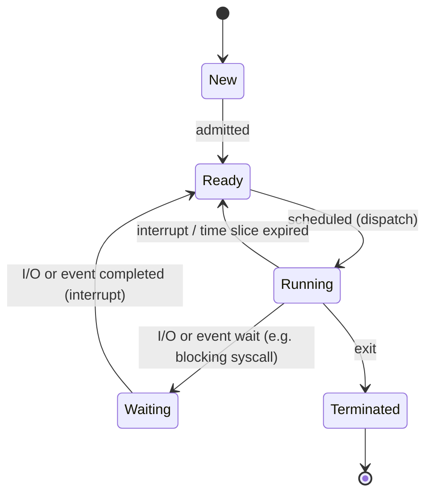

# Systems and Networking I — Part II: Process Management (Lectures 3–4)

Study notes for **Lecture 3 (Process Virtual Address Space and PCB)** and **Lecture 4 (Basics of OS Process Management)**.

> Exam format: multiple choice, ~20 questions, **+3** correct, **−1** wrong, **0** blank. Don't guess blindly.

## Table of contents

1. [Program vs process](#1-program-vs-process)
2. [Virtual address space](#2-virtual-address-space)
3. [The stack and stack frames](#3-the-stack-and-stack-frames)
4. [Process states](#4-process-states)
5. [Process state and the PCB](#5-process-state-and-the-pcb)
6. [Process creation](#6-process-creation)
7. [Process termination](#7-process-termination)
8. [Process scheduling and context switches](#8-process-scheduling-and-context-switches)
9. [Interprocess communication (IPC)](#9-interprocess-communication-ipc)
10. [Exam traps (Lectures 3–4)](#10-exam-traps-lectures-34)
11. [Practice questions (Rounds 1–4)](#11-practice-questions-rounds-14)
12. [Exam-style questions](#12-exam-style-questions)
13. [Oral exam questions](#13-oral-exam-questions)

---

## 1. Program vs process

A **program** is a static file on disk; a **process** is a running instance of it in main memory, with its own state.

| | Program | Process |
| --- | --- | --- |
| Where | Persistent storage (e.g. `/bin/ls` on disk) | Main memory (RAM) |
| Nature | **Static / passive**: just the instructions for a job | **Dynamic / active**: code + data + execution state |
| How many | One file | Many processes can run the same program, each with its own state (e.g. several Chrome windows) |

- A process is the **OS abstraction of a running program**: the **unit of execution**.
- A process executes **one instruction at a time, sequentially**.

The questions the OS must answer about processes:

- How are processes represented? → virtual address space + PCB
- What states can a process be in, and how does it move between them? → the 5 states
- How are processes created? → `fork` / `exec`
- How do processes communicate? → shared memory / message passing

---

## 2. Virtual address space

The OS gives **every process the same amount of virtual address space**: an abstraction of physical memory that looks like one contiguous range of addresses.

- Its range is **machine-dependent**. On a 32-bit machine, virtual addresses go from `0` to `2^32 − 1`, except some addresses reserved for the **OS kernel**.

### Layout (from high to low addresses)

| Segment | What it holds | Notes |
| --- | --- | --- |
| Kernel space | OS code and data | User code that touches it → segmentation fault |
| **Stack** | Data for each function call: parameters, return address, local variables (one **stack frame** per call) | LIFO; **grows down** (toward lower addresses) |
| *(free gap)* | Room for stack and heap to grow toward each other | |
| **Heap** | Dynamic allocation: `malloc` / `new`, freed with `free` / `delete` | **Grows up** (toward higher addresses) |
| **BSS** | Global and static variables **uninitialized or initialized to 0** | |
| **Data** | Global and static variables **initialized** (to a non-zero value) | |
| **Text** | Executable instructions | Lowest region |

> **Memory trick, bottom to top:** **T**ext → **D**ata → **B**SS → **H**eap ↑ … ↓ **S**tack → Kernel.

### Worked example: where each variable lives

```c
int w = 42;
int x = 0;
float y;

void doSomething(int f) {
    int z = 37;
    z += f;
}

int main() {
    char* c = malloc(128);
    int k = 12;
    doSomething(k);
}
```

| Item | Segment | Why |
| --- | --- | --- |
| Compiled code of `main`, `doSomething` | Text | Instructions |
| `w = 42` | Data | Global, initialized to non-zero |
| `x = 0` | BSS | Global, initialized to 0 |
| `y` | BSS | Global, uninitialized |
| `c` (the pointer variable) | Stack (main's frame) | Local variable |
| The 128 bytes `c` points to | Heap | Allocated by `malloc` |
| `k = 12` | Stack (main's frame) | Local variable |
| `f = 12` | Stack (doSomething's frame) | Parameter, a copy of `k` |
| `z = 37` | Stack (doSomething's frame) | Local variable |

> ⚠️ `c` itself lives on the **stack**, but what it points to lives on the **heap**.

---

## 3. The stack and stack frames

Two operations are defined on a stack: **push** (place an item on top) and **pop** (remove the top item). The stack grows **top-down**, from higher to lower addresses.

Every function call gets its own **stack frame** (activation record). Many frames can exist at once (nested calls), but **only one is active**: the top one.

### Two pointer registers

- **`esp` — stack pointer:** always points to the **top** of the stack. A push decrements it (by 4 bytes on a 32-bit machine) and copies the item there. It moves constantly.
- **`ebp` — base (frame) pointer:** **fixed** for the whole life of a frame. It gives the callee a stable reference point.

**Why `ebp` is needed:** `esp` keeps changing as the stack grows, so the callee would have no fixed reference to find its parameters. Solution: let `esp` move freely, and keep `ebp` fixed within each frame.

### The 3 parts of a frame

| Part | Set by |
| --- | --- |
| Function parameters + return address | The **caller** |
| Back-pointer to the previous frame (saved old `ebp`) | The **callee** |
| Local variables | The **callee** |

### What happens on `foo(a, b, c)`

1. The caller pushes the arguments in **reverse order**: `push c`, `push b`, `push a`.
2. `call foo` **implicitly pushes the return address**: the address of the instruction that **follows** the call.
3. The callee saves the caller's base pointer: `push ebp`.
4. The callee sets its own base: `mov ebp, esp`.
5. The callee makes room for its local variables below `ebp`.

### Addressing inside the callee's frame

```
higher addresses
  c                 ← ebp + 16
  b                 ← ebp + 12
  a                 ← ebp + 8
  return address    ← ebp + 4
  old ebp           ← ebp (+0)
  local variables   ← below ebp, reached through esp
lower addresses
```

- **Parameters:** positive offsets from **`ebp`**.
- **Local variables:** reached through **`esp`**.

### Cleanup and return

1. `mov esp, ebp` discards the local variables.
2. `pop ebp` restores the caller's base pointer.
3. The return pops the return address, and execution continues at the instruction after the call.

After the return, the callee's frame is gone and `esp` and `ebp` are back to the caller's values.

---

## 4. Process states

At any time, a process is in one of **5 states**:

| State | Meaning |
| --- | --- |
| **New** | The OS is setting up the process |
| **Ready** | Ready to execute, waiting to be scheduled on the CPU |
| **Running** | Actually executing instructions on the CPU |
| **Waiting** | Suspended, waiting for a resource or an event (keyboard input, disk access, timer…) |
| **Terminated** | Finished; the OS can destroy it |

A process moves between states because of:

- **program actions** (e.g. system calls)
- **OS actions** (e.g. scheduling)
- **external actions** (e.g. interrupts)

### State diagram



### Example: `printf("Hello World!");`

1. **New:** the process is set up.
2. **Ready:** it can run on the CPU.
3. **Running:** it executes.
4. **Waiting:** `printf` makes a **blocking I/O system call**. The process is suspended so the OS can schedule another ready process.
5. **Ready (not Running!):** when the I/O completes (hardware interrupt), the process goes back to **ready**. It is **not resumed directly**: the OS decides who runs next.
6. **Running:** eventually it is scheduled again.
7. **Terminated:** it finishes.

> ⚠️ **Waiting → Ready**, never Waiting → Running.

### Blocking system calls (again)

Most system calls (e.g. I/O) are **blocking**:

- **User space:** the calling process can't do anything until the call returns.
- **Kernel space:** the OS sets the process to **waiting** and schedules another **ready** process so the CPU isn't idle.
- When the call returns, the blocked process becomes **ready** again.

> **Only the calling process is blocked, not the whole system.**

---

## 5. Process state and the PCB

### What a process's state includes (at least)

- the **code** of the running program
- the **static data** of the running program
- the **program counter (PC)**: the next instruction to execute
- the **CPU registers**
- the **call chain (stack)**, with frame and stack pointers
- the **heap** (dynamic memory), with the heap pointer
- the **resources in use** (e.g. open files)
- the **execution state** (ready, running…)

### Process Control Block (PCB)

The **main data structure** the OS uses to keep track of a process: its execution state and location.

- The OS **allocates** a new PCB when a process is created and places it in a **state queue**.
- The OS **deallocates** the PCB when the process terminates.

**The PCB contains (at least):**

| Field | Contents |
| --- | --- |
| Process state | Ready, waiting, running… |
| Process number | Unique identifier (PID) |
| CPU context | Program counter (PC), stack pointer (SP), general-purpose registers |
| CPU scheduling information | Priority, pointers to state queues |
| Memory management information | Page tables |
| Accounting information | User and kernel CPU time consumed, owner |
| I/O status | List of open files |

---

## 6. Process creation

- Processes create other processes through **system calls**. The creator is the **parent**, the new one the **child**.
- The parent **shares resources and privileges** with its children.
- Each process has an integer **PID** (process identifier); its **parent's PID (PPID)** is also stored.

### UNIX/Linux

- The process scheduler is **`sched`**, with **PID 0**.
- At startup, `sched` launches **`init`**, with **PID 1**.
- `init` launches all system daemons and user logins, and becomes the **ultimate parent of all processes** (the process tree).
- Processes are created with the **`fork()`** system call.

### Child's address space: 2 possibilities

1. **Exact duplicate of the parent** (same program and data). Each has its **own PCB**: its own PC, registers and PID. → UNIX **`fork`**.
2. **A new program loaded** into the child's address space, with new code and data. → Windows **spawn**. UNIX does this as a **second step**, with **`exec`**.

### Parent after creating the child: 2 options

1. **Wait** for the child to terminate with a **`wait`** system call (for a specific child or any child). → The usual behavior of a UNIX shell.
2. **Run concurrently** with the child, without blocking. → A UNIX shell running a command in the background with **`&`**.

### `fork()` return values

| Where | `fork()` returns |
| --- | --- |
| In the **parent** | The **PID of the child** (> 0) |
| In the **child** | **0** |
| On error | −1 |

After `fork()` returns, **both** processes continue from the **same point**: the instruction right after the `fork()`.

Example layout: the parent (PID 74849, parent 65784) calls `fork()`. In the parent, `process_id = 74850`; in the child (PID 74850, parent 74849), `process_id = 0`. Each has its own stack, heap, data and code in memory.

### Code example (from the slides)

```cpp
#include <iostream>
#include <unistd.h>
using namespace std;

int main() {
    cout << "Current process ID is: " << getpid() << endl;
    cout << "\nCurrent parent's process ID is: " << getppid() << endl;

    int pid;
    pid = fork();
    // once fork() returns, both parent and child resume from here

    if (pid == 0) { // child
        cout << "\nThis is the child process with process ID = " << getpid() << endl;
        cout << "\nThis is the child process with parent's process ID = " << getppid() << endl;
    }
    else { // parent
        sleep(1); // to ensure the child finishes before the parent
        cout << "\nThis is the parent process with process ID = " << getpid() << endl;
        cout << "\nThis is the parent process with parent's process ID = " << getppid() << endl;
    }
    return 0;
}
```

**Slide question: what if the child sleeps instead of the parent?** The parent is likely to finish first. The child becomes an **orphan** and is adopted by **`init`**, so the child's `getppid()` may no longer print the original parent's PID (on traditional UNIX it prints 1).

### `fork` + `exec`: the UNIX shell

`fork` alone only makes **copies**. The goal is to create **new, different** processes.

- When you log in, a **shell** process starts.
- Every command you type creates a **child of the shell**.
- Two system calls happen: **`fork`** (create a new process) then **`exec`** (load and run the new program in it). Example: typing `emacs`.
- Adding **`&`** runs the child **in the background**, in parallel with the shell.

Typical pattern:

```c
pid_t pid = fork();
if (pid == 0) {
    execlp(cmd, cmd, NULL);   // child: replace its program with the one named cmd
} else {
    waitpid(pid, NULL, 0);    // parent: wait for that specific child to finish
}
```

### Building process hierarchies

**A chain of n processes** (A → B → C…): **n − 1 forks**, each inside the child branch.

```c
int pid = fork();
if (pid == 0) {          // B (A's child)
    pid = fork();
    if (pid == 0) {      // C (B's child)
        execlp(...);
    } else {             // B
        ...
    }
} else {                 // A
    ...
}
```

**n children of the same parent** (A0 → A1, A2, …, An): fork in a loop, and only the parent keeps looping.

```c
for (int i = 0; i < n; i++) {
    if (fork() == 0) {   // A0's child: do its work, then stop
        ...
        exit(0);
    }
    // else: back in the parent A0, keep forking
}
// parent A0: wait for all children
for (int i = 0; i < n; i++) wait(NULL);
```

Process trees are drawn **left to right** by convention.

> ⚠️ **Fork bomb:** `while (1) { fork(); }` creates an infinite number of processes, growing **exponentially**.

### Counting processes after forks

Each `fork()` executed by every existing process **doubles** the count.

> **n successive `fork()` calls (no conditions) → 2^n processes in total** (the original + 2^n − 1 new ones).

```c
fork();
fork();
fork();   // 2^3 = 8 processes, 7 of them new
```

With conditions, draw the tree:

```c
if (fork() == 0) {   // only the child enters
    fork();          // the child forks again
}
// P → C1, C1 → C2  →  3 processes in total
```

**Parent and child have separate copies of the variables** (the layout slide shows a separate stack, heap, data and code for each):

```c
int x = 5;
if (fork() == 0) {
    x = x + 1;
    printf("%d\n", x);   // child prints 6
} else {
    wait(NULL);
    printf("%d\n", x);   // parent prints 5: the child's change is not visible
}
```

### System calls seen so far

| System call | What it does |
| --- | --- |
| `fork` | Creates a new child process as an exact copy of the parent |
| `execlp` | Replaces the program of the current process with the named program |
| `sleep` | Suspends execution for a number of seconds |
| `wait` / `waitpid` | Waits for any / a specific child to finish |

---

## 7. Process termination

- A process requests its own termination with the **`exit`** system call, returning an **int**:
  - passed to the parent if it is doing a `wait`
  - usually **0 = success**, non-zero = a problem
- The **system** may also terminate a process:
  - it can't deliver the resources the process needs
  - in response to a **`kill`** command or another unhandled interrupt
  - a parent may kill children whose task is no longer needed
- If the parent exits, the system may or may not let the child continue.
- When a process terminates, all its resources are freed (open files flushed and closed, etc.). Its **termination status and execution times** go to the parent if it is waiting, or to `init` if the process is an orphan.

| Term | Meaning | What happens |
| --- | --- | --- |
| **Orphan** | Its parent has exited | Inherited by **`init`**, which then kills it |
| **Zombie** | Terminated, but its parent is **not waiting** for it, so it can't fully go away | Eventually inherited by `init` as an orphan and killed |

---

## 8. Process scheduling and context switches

### Goals of scheduling

1. **Keep the CPU busy** at all times.
2. Deliver **acceptable response times**, especially for interactive programs.

These goals can **conflict**. And every time the OS swaps processes, it uses CPU time that is "lost" for useful work.

### State queues

- The OS keeps the PCBs of all processes in **state queues**: **one queue per state** (5), plus typically **one queue per I/O device**.
- When a process changes state, its PCB is **unlinked** from the current queue and **moved** to the new one.
- Each queue can use its own management policy.

| Queue | Size limit |
| --- | --- |
| **Running** | **≤ number of cores** (one process per CPU at a time) |
| New, ready, waiting, terminated | Basically **unbounded** |

### Schedulers

| Scheduler | How often it runs | Role |
| --- | --- | --- |
| **Long-term** | Infrequently | Typical of batch or very heavily loaded systems |
| **Short-term** | **Very frequently** (~every 100 ms) | Must very quickly swap one process out of the CPU and another in |
| **Medium-term** | When load gets high | Lets smaller, faster jobs finish quickly to clear the system |

A good scheduler picks a **mix of CPU-bound and I/O-bound** processes.

### Context switch

**What:** the procedure to **suspend** the running process and **run a ready one**. It is **costly**:

- stopping a process = **saving** all its internal state (PC, SP, other registers) **to its PCB**
- starting a ready process = **loading** all its state **from its PCB**

**When:** on **any incoming trap** (system calls, exceptions, hardware interrupts). The CPU must:

1. save the state of the running process
2. switch to kernel mode to handle the trap
3. restore the state of the interrupted process (or of another one)

**Fairness:** I/O-bound processes get switched out by their own I/O requests. **CPU-bound** processes might **never** make an I/O request, so to stop them from hogging the CPU, context switches are also triggered by the **hardware timer interrupt** (the time slice).

### Time slice (quantum)

- The **maximum time between two context switches** (e.g. at least one every 50 ms; it can happen more often because of I/O).
- Implemented in hardware with the **timer interrupt**.
- Used by modern time-sharing, multitasking OSs to increase **responsiveness** (pseudo-parallelism).

### How often? The trade-off

The time spent on a context switch is **wasted CPU time**.

| Time slice | Context switches | Effect |
| --- | --- | --- |
| **Smaller** | More frequent | **Better responsiveness** |
| **Larger** | Less frequent | **Less wasted CPU** → better CPU utilization |

Typical values: time slice **10–100 ms**, context switch **~10 µs**, so the overhead is small.

```
overhead ≈ switch time / (time slice + switch time)
e.g. 10 µs / (50 ms + 10 µs) ≈ 0.02 %
```

---

## 9. Interprocess communication (IPC)

| Kind | Meaning |
| --- | --- |
| **Independent** processes | Run concurrently; can neither affect nor be affected by other processes |
| **Cooperating** processes | Can affect or be affected by others, to achieve a common task |

### Why cooperate?

- **Information sharing:** several processes need the same file (e.g. pipelines).
- **Computation speedup:** split a problem into sub-tasks solved simultaneously.
- **Modularity:** a system broken into cooperating modules.
- **Convenience:** one user multitasking (editing, compiling, printing…).

### Shared memory vs message passing

| | Shared memory | Message passing |
| --- | --- | --- |
| Speed | **Faster** once set up: **no system calls** needed | **Slower**: a **system call for every message** |
| Setup | More complicated; doesn't work well across computers | Simpler; works well across computers |
| Best when | **Large** amounts of data on the **same** computer | **Small** or infrequent transfers, or **multiple computers** |

### Shared memory systems

- The memory to share starts in **one process's address space**.
- That process makes **system calls** to make it available.
- Other processes make **their own system calls** to **attach** it to their address space.

### Message passing systems

Must support at least **send** and **receive** system calls. A **communication link** must be set up first. 3 key issues: **naming**, **synchronization**, **buffering**.

**Naming:**

| | Direct communication | Indirect communication |
| --- | --- | --- |
| How | The sender must know the **receiver's name** | Uses shared **mailboxes** or **ports** |
| Link | One-to-one link per sender-receiver pair (symmetric: the receiver also knows the sender) | Many processes can share a mailbox; **only one** process can read a given message |
| OS support | — | System calls to create/delete mailboxes and send/receive to/from them |

**Buffering and synchronization:**

| Queue capacity | Sender behavior |
| --- | --- |
| **Zero** | Messages can't be stored → sender **must block** until the receiver accepts |
| **Bounded** | Sender **blocks if the queue is full**; otherwise blocking or non-blocking |
| **Unbounded** | Theoretically infinite → sender **never forced to block** |

---

## 10. Exam traps (Lectures 3–4)

- Program = **static**, on disk. Process = **dynamic**, in memory, with state.
- A global initialized to **0** goes to **BSS**, not Data.
- A local pointer is on the **stack**; the memory `malloc` returns is on the **heap**.
- Stack grows **down**; heap grows **up**.
- The stack frame holds the arguments of a **function** (not a system call) and the return address = the instruction that **follows** the call.
- Caller sets parameters + return address; callee sets saved `ebp` + locals.
- Parameters: positive offsets from **`ebp`**; locals: through **`esp`**.
- **Running → Waiting:** blocking I/O or waiting for an event (e.g. **keyboard input**).
- **Running → Ready:** interrupt / **time slice expired**.
- **Waiting → Ready**, never directly to Running.
- A blocking call blocks **only the calling process**, not the system.
- The PCB is created at process creation and freed at termination; it holds state, PID, PC/SP/registers, scheduling, memory (page tables), accounting and I/O info.
- `fork()` returns the **child's PID in the parent** and **0 in the child**.
- n plain `fork()` calls → **2^n** processes in total.
- Parent and child have **separate copies** of variables.
- `fork` copies; `exec` **replaces** the program. A shell uses both.
- `sched` = PID **0**; `init` = PID **1**.
- Orphan: parent gone → adopted by `init`. Zombie: finished but parent not waiting.
- Running queue **≤ number of cores**; the other queues are unbounded.
- Short-term scheduler runs **most often** (~100 ms).
- Context switch: state saved **to the PCB**; triggered by **any trap**, including the **timer**.
- Smaller time slice → more responsive, more overhead.
- Shared memory: faster, no syscalls after setup. Message passing: a syscall per message, works across computers.
- Zero-capacity buffer → sender always blocks.

---

## 11. Practice questions (Rounds 1–4)

### Round 1: Address space and stack frames

1. `static int counter;` declared inside a function. Which segment holds it?
2. `char *buf = malloc(64);` inside `main`. Where is `buf`, and where are the 64 bytes?
3. In a stack frame, which part is set by the caller and which parts by the callee?
4. Why do we need `ebp` when we already have `esp`?
5. Inside `foo(a, b, c)`, at what offset from `ebp` is `b`?
6. The stack frame contains at least:
   (a) the arguments of a function and the address of the instruction that precedes its call
   (b) the arguments of a system call and the address of the instruction that follows its call
   (c) the arguments of a function and the address of the instruction that follows its call
   (d) none of the above

<details>
<summary>Answers (Round 1)</summary>

1. **BSS**: static and uninitialized.
2. `buf` is on the **stack** (local of `main`); the 64 bytes are on the **heap**.
3. Caller: **parameters + return address**. Callee: **saved old `ebp`** and **local variables**.
4. `esp` moves constantly; `ebp` stays **fixed** within the frame, so parameters can be found at fixed offsets.
5. **`ebp + 12`** (`a` at +8, `b` at +12, `c` at +16).
6. **(c)**.

</details>

### Round 2: States and the PCB

1. A process is waiting for keyboard input. Which state is it in?
2. What makes a process go from running to ready? From running to waiting?
3. A waiting process's I/O completes. Does it go straight back to running?
4. A process makes a blocking `read()`. Is the whole system blocked?
5. Name 4 fields of the PCB.

<details>
<summary>Answers (Round 2)</summary>

1. **Waiting.**
2. Running → ready: an **interrupt**, e.g. the **time slice expires**. Running → waiting: a **blocking I/O call** or waiting for an event.
3. **No.** It goes to **ready**; the scheduler decides when it runs.
4. **No**, only the calling process. The OS runs another ready process.
5. Any 4 of: process state, PID, PC + SP + registers, scheduling info, memory management info (page tables), accounting info, I/O status (open files).

</details>

### Round 3: Creation and termination

1. What does `fork()` return in the parent, and in the child?
2. How many processes exist in total after `fork(); fork(); fork();`?
3. How many processes in total after `if (fork() == 0) { fork(); }`?
4. In the `x = 5` example, what do the child and the parent print?
5. What is the difference between a zombie and an orphan?
6. Why does a UNIX shell use both `fork` and `exec`?

<details>
<summary>Answers (Round 3)</summary>

1. Parent: the **child's PID**. Child: **0**.
2. **8** (2^3), 7 of them new.
3. **3**: the parent, its child, and the child's child.
4. Child prints **6**, parent prints **5**: separate copies.
5. **Zombie:** has terminated, but its parent isn't waiting for it. **Orphan:** its parent has exited; it is adopted by `init`.
6. `fork` only creates a **copy** of the shell; `exec` then **replaces** that copy's program with the command to run. The shell (parent) can then `wait` for it, or keep running if `&` was used.

</details>

### Round 4: Scheduling, context switches, IPC

1. A 4-core machine has 30 processes. Max PCBs in the running queue? Is the ready queue bounded?
2. Which scheduler runs most often?
3. During a context switch, what is saved, and where?
4. What is the effect of a smaller time slice?
5. Time slice = 50 ms, context switch = 10 µs. Roughly what fraction of CPU time is overhead?
6. Which IPC method needs a system call for every transfer?
7. With a zero-capacity message queue, what must the sender do?

<details>
<summary>Answers (Round 4)</summary>

1. **4**. The ready queue is basically **unbounded**.
2. The **short-term** scheduler (~every 100 ms).
3. PC, SP and the other registers, saved **to the process's PCB**.
4. More context switches: **better responsiveness**, but **more wasted CPU**.
5. `10 µs / (50 ms + 10 µs)` ≈ **0.02 %**.
6. **Message passing.**
7. **Block** until the receiver accepts the message.

</details>

---

## 12. Exam-style questions

> **Reconstructed** in exam format from the Process Management topics that appeared in past exams and in the question bank (running→waiting, process creation, PCB, counting forks, stack frame, fork variables, ready queue on m cores, CPU-bound processes). They are not the verbatim exam text.

1. A running process asks for keyboard input. It moves to the state:
   (a) ready (b) waiting (c) terminated (d) new

2. A new process is created in UNIX:
   (a) by the CPU scheduler automatically
   (b) through a system call (`fork`)
   (c) only by the `init` process
   (d) by a hardware interrupt

3. The execution state of a process (ready, running…) is stored in:
   (a) the stack (b) the heap (c) the PCB (d) the BSS

4. A program executes three `fork()` calls in a row, with no conditions. How many processes exist in total (including the original)?
   (a) 3 (b) 4 (c) 6 (d) 8

5. The stack frame contains at least:
   (a) the arguments of a function and the address of the instruction that follows its call
   (b) the arguments of a system call and the address of the instruction that follows its call
   (c) the arguments of a function and the address of the instruction that precedes its call
   (d) none of the above

6. Consider:
   ```c
   int v = 10;
   if (fork() == 0) { v = 20; }
   else { wait(NULL); printf("%d", v); }
   ```
   What does the parent print?
   (a) 10 (b) 20 (c) 30 (d) it depends on the scheduler

7. On a machine with m cores, how many processes can be in the running state at the same time?
   (a) exactly 1 (b) at most m (c) at least m (d) unlimited

8. A CPU-bound process that never performs I/O can leave the running state:
   (a) never
   (b) only when it terminates
   (c) when the timer interrupt ends its time slice, or when it terminates
   (d) only through a blocking system call

9. A process in the waiting state whose I/O has completed moves to:
   (a) running (b) ready (c) new (d) terminated

10. A global variable declared as `int counter = 0;` is stored in:
    (a) Data (b) BSS (c) Heap (d) Stack

11. A process whose parent terminated without waiting for it is:
    (a) a zombie, adopted by `sched`
    (b) an orphan, adopted by `init`
    (c) immediately moved to the ready queue
    (d) none of the above

12. Which statement about context switches is correct?
    (a) They save the process state to the heap
    (b) They are free in terms of CPU time
    (c) They save the process state to its PCB and can be triggered by any trap, including the timer
    (d) They only occur when a process terminates

<details>
<summary>Answers (Exam-style)</summary>

1. **(b)** 2. **(b)** 3. **(c)** 4. **(d)** 2^3 = 8 5. **(a)** 6. **(a)** separate copies 7. **(b)** 8. **(c)** 9. **(b)** 10. **(b)** initialized to 0 → BSS 11. **(b)** 12. **(c)**

</details>

---

## 13. Oral exam questions

Open questions on these lectures from the oral exam list. Answer them out loud using the sections above.

1. What happens when there is a function call? What happens to the stack pointers? What does memory look like after it returns?
2. Describe all the process states and the transitions between them.
3. How is a process in the waiting state notified that it can continue?
4. What is the PCB, and what does it contain?
5. How are processes created? Explain `fork` (also "explain it like I'm 5").
6. Why are `fork` and `exec` separate?
7. Give an example of processes in a web browser.
8. How do processes communicate with each other?
9. What is multiprogramming?
